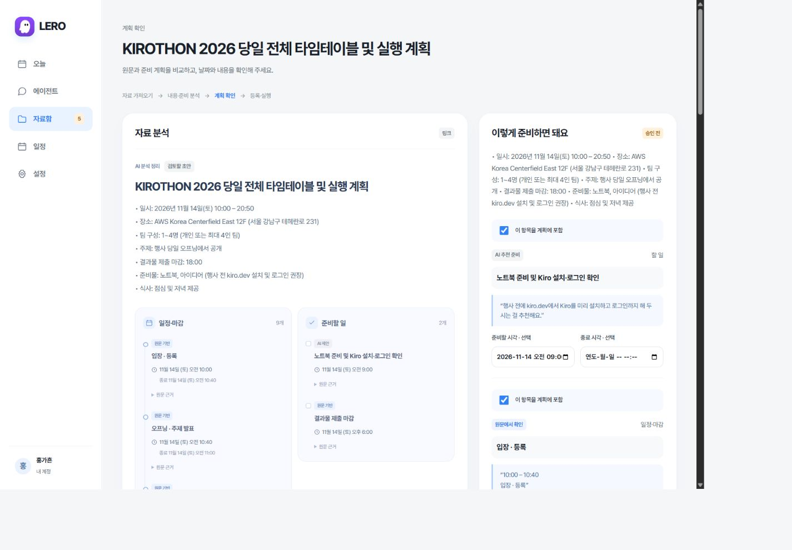
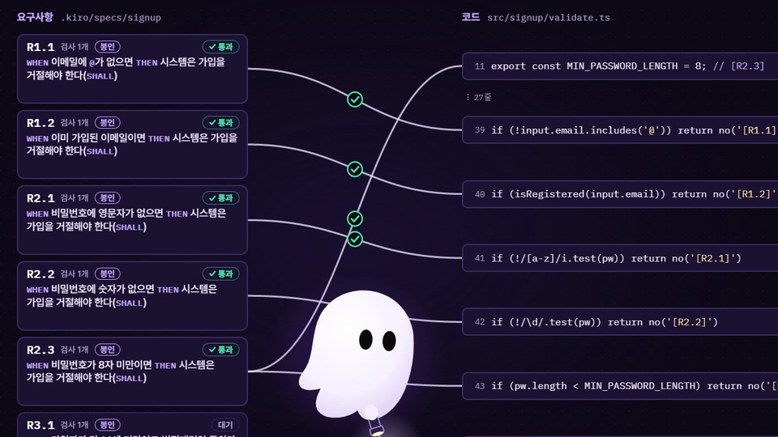
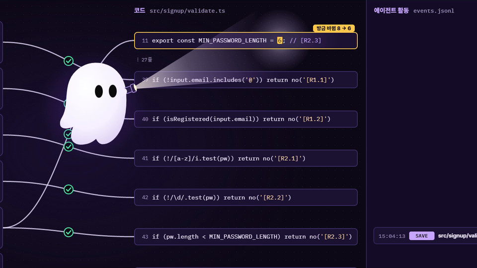
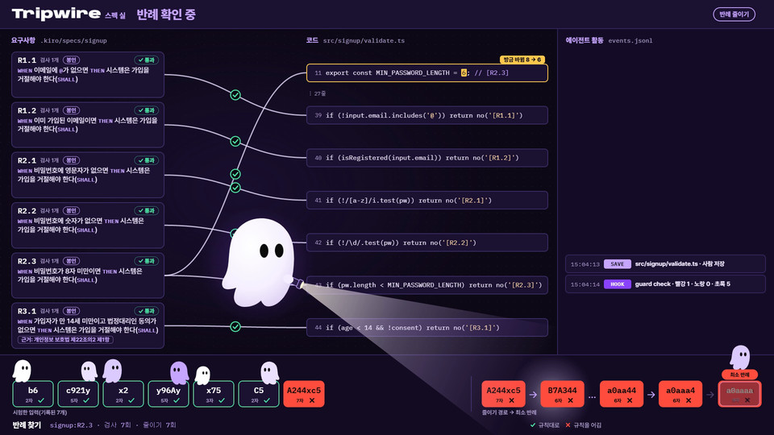
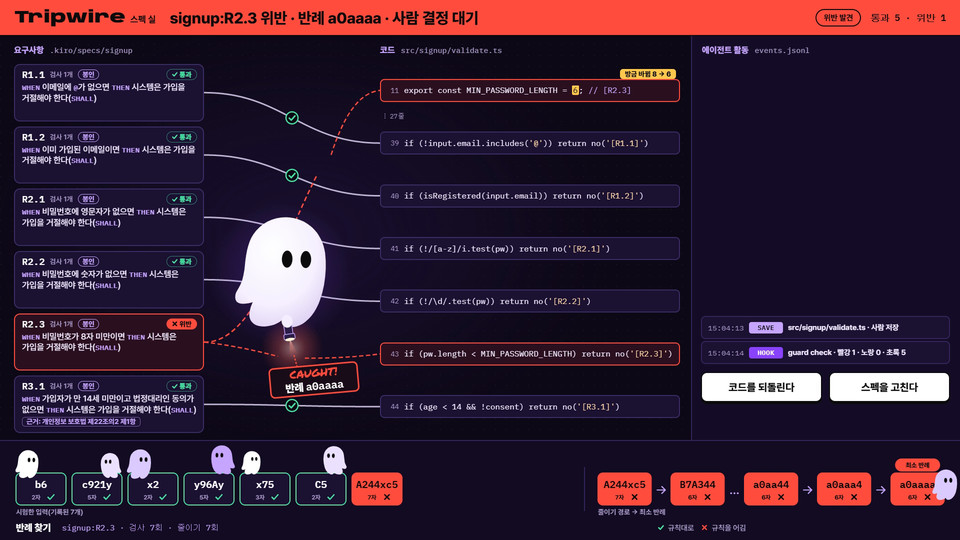
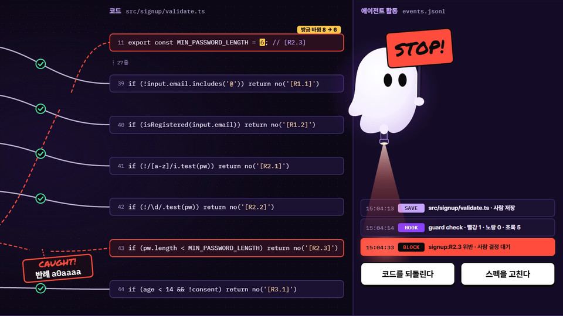

<h1 align="center">LERO AI Agent — 공지를 다음 행동으로<br><sub>공지 실행 에이전트 + Kiro Power Tripwire</sub></h1>

<p align="center">캡처·문서·메일 공지를 근거가 있는 실행 계획으로 바꾸고, 승인부터 완료까지 이어 간다.<br>
그 판정 코드의 스펙을 지키기 위해 Kiro 파워 Tripwire를 실제 Python 서버에 적용했다.</p>

<p align="center">
  
  
  
  <a href="#kiro-power--tripwire"></a>
</p>

<p align="center">
  <a href="#1-문제-정의">문제 정의</a> ·
  <a href="#2-핵심-기능">핵심 기능</a> ·
  <a href="#3-사용-시나리오">사용 시나리오</a> ·
  <a href="#6-설치와-실행">설치와 실행</a> ·
  <a href="#kiro-power--tripwire">Kiro Power</a> ·
  <a href="BUILD_REPORT.md">BUILD REPORT</a>
</p>

**Demo:** [LERO AI Agent 배포 서비스](https://ai-hackathon.cloud)

| 데모 | 보여 주는 것 | 주소·영상 |
|---|---|---|
| 🗓️ **LERO AI Agent** | 공지 → 근거·계획 검토 → 승인 → 일정·할 일 → 완료 | [서비스 열기](https://ai-hackathon.cloud) |
| 🛡️ **Tripwire** — Kiro Power | 기준을 어긴 저장 → 반례 → Kiro 차단 → 사람의 결정 → 복구 | [영상 보기](https://drive.google.com/file/d/1kThXh9NlS03dPeu2xSn-zYvGBL4IH7N_/view?usp=sharing) |

> **데모 준비 완료:** 백엔드 검사 366개 통과. 공식 KIROTHON 시간대 9개와 할 일 2개를 분석하고 지난 준비 추천을 제외해 10개를 승인했다. Calendar 일괄 반영 9건 성공·0건 실패, 실제 0→9개 확인, 대화의 오늘 일정 9개·KST 시간 응답과 새로고침 후 대화 유지까지 검증했다. 검증용 9개 일정과 LERO 자료를 정리해 현재 시작 화면은 0건이며 로그인·연결·대화는 유지했다. [3분 데모 진행표](docs/DEMO.md).

### 이 레포에 담긴 두 가지

<table>
<tr>
<td width="50%" valign="top">
<h4>🗓️ LERO AI Agent — 공지 → 실행 계획 → 완료</h4>
<br>
학교·회사·행사 공지를 넣으면 원문 근거와 준비 계획을 보여 준다. 선택·수정·명시적 승인 후 일정과 할 일을 만들고 완료까지 관리한다.<br><br>
<b>위치</b> <code>app/chaenggim/</code> · <code>app/web/</code>
</td>
<td width="50%" valign="top">
<h4>🛡️ Tripwire — Kiro Power</h4>
<br>
이 프로젝트를 위해 만든 Kiro 파워. 스펙의 수용 기준을 실행 가능한 검사로 바꾸고, 코드나 에이전트가 기준을 어기면 반례로 잡아 Kiro 에이전트의 다음 작업을 막는다.<br><br>
<b>위치</b> <code>power/tripwire/</code> · <code>guard/</code> · <code>ui/</code>
</td>
</tr>
</table>

> Kiro를 개발 과정의 어디에 어떻게 썼는지는 [BUILD_REPORT.md](BUILD_REPORT.md)에 두 갈래(LERO · Tripwire)로 나눠 단계별로 적었다.

---

## 1. 문제 정의

### 대상 사용자

학교 안내문에서 신청·준비물·제출 기한을 챙기는 보호자와 학생, 여러 메일과 웹 공지에서 일정과 준비 업무를 관리하는 직장인·행사 참가자다.

### 문제 상황

공지 한 장에는 행사 날짜뿐 아니라 신청 마감, 제출물, 준비물, 참가 조건이 함께 들어 있다. 캡처와 링크를 보관해도, 다시 원문을 찾아 읽고 각각의 일을 달력과 할 일 앱에 옮겨야 한다. 수정 공지가 오면 기존 계획과 무엇이 달라졌는지도 직접 비교해야 한다.

예를 들어 “일요일 워크숍, 토요일 오후 6시 신청 마감, 노트북·충전기 지참”이라는 공지는 행사 참석, 사전 신청, 준비물 확인이라는 서로 다른 행동을 요구한다. 행사 시간만 달력에 넣으면 신청과 준비가 남는다.

### 기존 방식과 한계

스크린샷·메일 보관은 원문을 남기지만 실행 목록을 만들지 않는다. 달력에 직접 입력하면 행사 시간과 준비 업무를 여러 번 나눠 옮겨야 한다. 요약문을 받아도 어떤 내용이 원문에 있고 어떤 준비 단계가 추천인지 확인하고, 실제 등록과 완료 관리를 이어 가는 일이 남는다.

### 근거

학교·행사 공지의 날짜·준비물·신청 조건을 담은 테스트 자료와 [KIROTHON 공식 안내](https://kirothon.ausg.me)를 분석해 초안이 만들어지는 흐름을 확인했다. 실제 텍스트·이미지·공개 웹 입력을 사용했고, 원문 근거가 있는 항목과 추천 항목을 확인했다. 사용자 조사나 시간 절감 벤치마크를 수행한 것으로 주장하지 않는다.

### 목표

공지 수집에서 근거 확인, 계획 수정, 명시적 승인, 일정·할 일 등록, 완료와 변경 반영까지 한 흐름으로 연결한다. 확인되지 않은 날짜는 질문으로 남기고, 외부 서비스 연결은 사용자가 선택한다.

## 2. 핵심 기능

**LERO AI Agent — 공지 → 실행 계획 → 완료**

| 기능 | 해결하는 불편 | 코드 위치 |
|---|---|---|
| URL·텍스트·PNG·JPEG·PDF 입력 | 캡처·문서·웹 공지를 다시 타이핑하는 수고 | `app/chaenggim/intake.py`, `app/chaenggim/vertex.py` |
| 원문 근거와 AI 추천 구분 | 공지의 사실과 추가 제안을 구별하기 어려움 | `app/chaenggim/domain.py`, `app/web/` |
| 선택·수정·명시적 승인 | 원치 않는 항목이나 불확실한 시각이 바로 등록되는 문제 | `app/chaenggim/domain.py`, `app/chaenggim/rules.py` |
| 내부 일정·할 일·완료·수정 공지 반영 | 같은 자료의 계획을 여기저기서 관리하는 수고 | `app/chaenggim/domain.py`, `app/chaenggim/api.py` |
| 대화로 조회·초안 편집·완료·연결 작업 요청 | 작업마다 메뉴를 찾아 이동하는 수고 | `app/chaenggim/chat.py` — Drive 검색·가져오기·승인과 Tasks 완료 반영 확인 |
| 승인한 일정의 Google Calendar 연결·ICS 내보내기 | 평소 쓰는 달력으로 다시 옮기는 수고 | `app/chaenggim/calendar.py`, `app/chaenggim/calendar_export.py` |
| Google Tasks 연결 | 승인한 준비 업무를 할 일 앱에 다시 입력하는 수고 | `app/chaenggim/google_products.py` — 실제 생성·대화 완료 후 상태 반영 확인 |
| Drive 파일 선택 | Drive 안내문을 따로 내려받는 수고 | `app/chaenggim/google_products.py` — 대화 검색·선택·가져오기·분석·승인 확인 |
| Gmail 조건 수집 | 메일 공지를 다시 입력하는 수고 | `app/chaenggim/gmail.py` — 분류 추가 전 실제 메일 3건 → 초안 3개 확인. 선택적 실행 필요성 분류 구현, 실제 메일 검증 대기 |
| 로그아웃·계정 탈퇴 | 앱의 계정·자료·연결 정보를 직접 정리하기 어려움 | `app/chaenggim/accounts.py` — 실제 로그아웃 확인, 탈퇴 API·소유권·세션 정리 통합 검사 통과(실계정 탈퇴는 실행하지 않음) |

**🛡️ Tripwire — Kiro Power**

| 기능 | 해결하는 불편 | 코드 위치 |
|---|---|---|
| 수용 기준 → 속성 검사 — 스펙의 기준마다 fast-check 검사를 만들고 변형 구현으로 검사를 검사한 뒤 봉인 | 테스트가 코드를 따라 함께 틀려 위반을 못 잡는 것 | `power/tripwire/skills/`, `guard/src/adopt.ts` |
| 바뀔 때마다 검사 — Kiro가 쓰면 hook이, 사람이 저장하면 `guard serve`가 검사 | 스펙을 벗어난 것을 뒤늦게 아는 것 | `guard/src/check.ts`, `guard/src/humanwatch.ts` |
| 반례와 차단 — 어긴 기준과 최소 반례를 보여 주고 Kiro의 다음 쓰기·셸을 멈춤 | 에이전트가 잘못된 코드를 계속 쌓는 것 | `guard/src/gate.ts`, `ui/` |

## 3. 사용 시나리오

1. Google로 로그인하고, 워크숍 안내문을 붙여 넣거나 캡처를 올린다.
2. LERO가 행사 시간, 신청 기한, 준비물을 정리하고 각 항목의 원문 근거를 보여 준다. 원문에 없는 준비 단계는 AI 추천으로 표시한다.
3. 날짜가 불확실하면 질문을 확인한다. 등록할 항목만 선택하고 제목·시각을 수정한다.
4. 계획을 명시적으로 승인하면 내부 일정과 할 일이 만들어진다. 승인 전에는 초안으로 남는다.
5. 오늘 해야 할 일을 확인하고 신청·준비가 끝나면 완료한다. 필요하면 선택적으로 Google Calendar·Tasks에 연결한다.
6. 수정 공지가 오면 기존 자료에 연결해 다시 검토한다. 달라진 계획을 승인한 뒤 반영한다.

대화 기능은 서버가 허용한 도구로 자료 검색·가져오기, 초안 검토, 승인한 항목의 조회·완료·연결을 처리한다. 계획 승인은 별도의 명시적 동작이며, 현재 자료에 대한 후속 질문은 그 자료의 문맥을 사용한다. 새 대화·자료 질문은 구현 및 단위 검사를 마쳤다. v9에서 공식 KIROTHON 당일 전체 타임테이블을 분석했으며, 일괄 Calendar 반영 9건 성공과 오늘 일정 대화 조회를 실제 계정으로 확인했다.

Gmail은 사용자가 설정한 검색 조건에서 한 번에 새 메일 최대 10건을 확인한다. 선택적 Cloud AI 분류가 실행 계획이 필요하지 않다고 판단하면 건너뛰고, 필요한 메일만 초안 분석으로 넘긴다. 이 분류를 포함한 실제 메일 E2E는 아직 확인 전이며 자동 수집은 데모에서 끈다.

## 4. 기대 효과

공지마다 원문을 다시 찾아 여러 앱에 옮기는 부담을 줄이고, 행사 참석 전에 필요한 신청·제출·준비 업무를 함께 관리하도록 돕는다. 항목에서 원문으로 돌아갈 수 있어 사용자가 날짜와 조건을 검토할 수 있다.

이번 구현에서는 입력 → 검토 → 승인 → 저장 → 완료 흐름과 390px 모바일 화면을 확인했다. 시간 절감률·분석 정확도·누락 감소율의 정량 성과는 아직 측정하지 않았다. 후속 검증에서는 **공지 1건당 등록 시간(초)**, **필수 업무 누락 수(개)**, **사용자가 수정한 항목 수(개)**를 측정한다.

## 5. 차별점

- **행사와 준비 업무를 함께 관리한다.** 신청·제출 마감과 준비물을 실행 항목으로 나누고, 완료와 수정 공지 반영까지 이어 간다.
- **원문 사실과 추천의 출처를 드러낸다.** 근거 문구와 추천 표시를 보고 사용자가 항목을 선택·수정한다.
- **승인과 실행을 서버에서 관리한다.** 소유권·승인·버전·중복·날짜·알림 규칙은 결정적 판정 함수가 확인한다. 분석 결과가 그대로 실행 권한이 되지 않는다.
- **외부 연결은 선택이다.** 내부 일정·할 일 관리 위에 Calendar·Tasks를 연결하고, Drive는 서버의 읽기 전용 API로 파일을 가져온다. Google 접근 토큰은 브라우저에 전달하지 않는다.
- **실제 Python 판정 코드를 Tripwire로 보호한다.** Kiro가 만든 속성 검사는 브리지를 거쳐 서버의 `rules.check`를 실행한다. 날짜 없는 행사 거절과 한국 시각 심야 알림 거절, 두 수용 기준을 채택·봉인했다.

- **Kiro Power Tripwire:** 테스트가 코드를 따라 함께 틀리는 문제를 막는다. 수용 기준마다 속성 검사를 만들고, 일부러 틀린 구현(변형)을 잡는지 확인한 뒤 봉인한다. 누가 기준을 어기게 코드를 바꾸면 반례가 나오고 Kiro 에이전트의 다음 작업이 막힌다.

---

## 6. 설치와 실행

**필요한 것:** Node.js 22 이상, Kiro IDE 또는 Kiro CLI

```bash
# 1. 의존성 설치
npm install
cd demo && npm install && cd ..

# 2. guard 빌드와 검사
npx tsc
npx vitest run

# 3. Kiro Power 설치 (Kiro CLI)
kiro-cli powers install power/tripwire

# 4. 스펙 실 화면 (예제 작업 공간)
cd demo
node ../guard/dist/cli.js serve
```

### LERO 앱

**앱 실행에 필요한 것:** Python 3.13. 속성 검사를 실행하려면 Node.js 22 이상, 실제 분석에는 Google Cloud 인증과 분석 서비스 설정이 필요하다. Kiro Power를 설치·검증할 때는 Kiro CLI를 사용한다.

저장소 루트에서 Windows PowerShell로 실행한다.

```powershell
cd app
python -m venv .venv
.venv\Scripts\python.exe -m pip install -r requirements-dev.txt
.venv\Scripts\python.exe -X utf8 run.py --demo
```

[로컬 화면](http://127.0.0.1:4871)을 연다. `--demo`는 로컬 체험 계정만 제공한다. 실제 분석과 Google 서비스 사용에는 아래 설정이 필요하다. macOS·Linux에서는 `.venv\Scripts\python.exe` 대신 `.venv/bin/python`을 사용한다.

| 설정 | 용도 |
|---|---|
| `APP_ORIGIN` | 로컬 기본값 `http://127.0.0.1:4871`. OAuth 리디렉션 URI는 같은 origin의 `/auth/callback` |
| `GOOGLE_CLIENT_ID`, `GOOGLE_CLIENT_SECRET` | 실제 Google 로그인과 사용자가 선택한 서비스 권한 연결 |
| `GCP_PROJECT`, `GCP_ACCOUNT` | 로컬 Google Cloud 프로젝트와 CLI 인증 계정. 로컬에서 `gcloud auth login` 필요 |
| `VERTEX_MODEL` | 실행 환경에 설정하는 분석 서비스 식별자 |
| `TOKEN_ENCRYPTION_KEY` | Google 토큰 저장용 암호화 키. 로컬은 미설정 시 기기 내부 키 생성 |
| `SOURCE_BUCKET` | Cloud Run에서 첨부를 보관하는 비공개 Cloud Storage 버킷 |

설정은 `app/.env` 또는 실행 환경에 둔다. 비밀 값, `.env`, 로컬 키와 사용자 데이터는 커밋하지 않는다. Cloud Run에서는 서비스 계정·Firestore·비공개 Cloud Storage를 사용하며, 로컬에서는 SQLite를 사용한다.

## 7. 테스트

```bash
npx vitest run            # guard 자체 검사
cd demo && npx vitest run # 예제의 봉인된 속성 검사 6개
```

### LERO 앱

아래 명령은 저장소 루트에서 새 터미널을 열어 실행한다.

```powershell
cd app
.venv\Scripts\python.exe -X utf8 -m pytest
npm ci
npm test
```

Python 검사는 계획 승인·소유권·입력 제한·서비스 어댑터·계정 처리 등을 확인한다. `npm test`의 속성 검사는 TypeScript의 판정 복제본 대신 실제 Python `rules.check`를 호출한다. 봉인된 검사는 수정하지 않는다.

| 확인 범위 | 현재 근거 |
|---|---|
| 최신 백엔드 통합 검사 | 366개 통과. 당일 전체 타임테이블·새 대화·자료 질문·외부 도구 경계 포함 |
| 봉인된 속성 검사 | 최종 제출본에서 실제 Python 판정의 봉인 검사 2개 통과(기준별 fast-check 100회) |
| 프런트 문법 검사 | JavaScript 문법 검사와 v9 공식 링크 → 승인 → Calendar 일괄 반영 → 대화 조회 브라우저 검증 통과 |
| Tasks·Drive 어댑터 | `app/tests/test_google_products.py` 65개 통과. 모의 HTTP로 소유권·승인·응답 유실·중복 방지·충돌·4MB 스트리밍 제한 검사 |
| ICS 내보내기 | Kiro CLI가 `app/chaenggim/calendar_export.py`와 검사 9개 구현 |
| 실제 분석 입력 | 텍스트·이미지·공식 공개 웹 안내로 분석 실행 확인 |
| 로컬 브라우저 | 미리보기 → 승인 → 저장 → 완료, 캘린더, 390px 모바일 화면 확인 |
| 배포·실제 URL 분석 | v9에서 공식 URL의 시간대 9개·할 일 2개 분석 → 지난 준비 추천 제외 → 10개 승인 확인 |
| 당일 Calendar 일괄 실행·조회 | 9건 성공·0건 실패, 실제 Google Calendar 0→9개 및 정확한 오늘 일정 질문에 9개·KST 시간 응답 확인. 대화 ID 새로고침 유지 |
| 깨끗한 시작 상태 | 검증용 원격 일정 9개만 식별·삭제 후 오늘 0건 확인. LERO 자료·초안·항목·메일 중복 표식 0건, 자동 수집 끔. 로그인·연결·대화 유지 |
| 실제 Google 로그인·권한 | 프로덕션 재로그인·로그아웃 및 Calendar·Tasks·Drive 권한 연결 확인 |
| 실제 Calendar·Tasks | 테스트 일정·할 일 생성과 대화 완료 후 Tasks 반영 확인 |
| 실제 Drive 흐름 | 대화 검색 → 파일 선택·가져오기 → 3개 항목 분석 → 승인 확인 |
| 실제 Gmail 수집 | 선택적 분류 추가 전 `subject:KIROTHON newer_than:30d`로 메일 3건 → 초안 3개 확인. 자동 수집 끔 |
| 입력 보안 검사 | 미국 리전 Model Armor PIJ 설정. 인증 사용자로 한국어·영어 정상/공격 텍스트, 정상 PNG, 정상/공격 PDF 검사 확인. 앱 런타임 계정의 실제 정상 공지 ALLOW·분석 경로 확인 |
| 앱 Kiro hook 호출 | SessionStart, ICS 소스·단위 검사 쓰기, pytest 셸 실행, PostToolUse의 두 기준 green 기록 확인 |
| 검증 범위의 한계 | 실제 메일 선택적 분류, LERO의 위반 후 작업 차단은 별도 확인. Model Armor 앱 정상 입력 ALLOW는 확인했으며 프로덕션 공격 UI 차단 성공으로 확장하지 않음 |

증거 화면: [분석 계획](docs/media/lero-plan.jpg) · [Calendar 검증 전](docs/media/demo-calendar-before.jpg) · [9개 반영 후](docs/media/demo-calendar-after.jpg) · [오늘 일정 대화](docs/media/demo-calendar-chat.jpg) · [정리 후 시작 화면](docs/media/lero-demo-ready.jpg)

Google OAuth는 외부 사용자용 프로덕션으로 공개했으며 기본 로그인을 제공한다. 추가 서비스 권한의 Google 검증이 끝났다는 뜻은 아니다. 민감한 권한은 계정·권한에 따라 Google의 경고나 접근 제한이 적용될 수 있다.

---

## Kiro Power — Tripwire

Kiro 스펙의 수용 기준(EARS)을 fast-check 속성 검사로 실행해, 코드나 자율 에이전트가 스펙을 벗어나는 순간 반례로 잡는 Kiro 파워다. 판정은 코드가 하고, 결정은 사람이 한다. `guard serve` 화면에서는 검사관이 수용 기준과 코드 줄을 잇는 실을 따라 순찰한다.

**데모 영상:** [Tripwire가 스펙 위반을 잡고 Kiro를 막는 과정](https://drive.google.com/file/d/1kThXh9NlS03dPeu2xSn-zYvGBL4IH7N_/view?usp=sharing)

<table>
<tr>
<td width="50%" valign="top">
<br>
<b>1. 수용 기준을 코드와 잇는다</b><br>
수용 기준마다 봉인된 속성 검사가 있고, 실이 기준과 코드 줄(<code>[R2.3]</code>)을 잇는다.
</td>
<td width="50%" valign="top">
<br>
<b>2. 코드가 바뀌면 바로 검사한다</b><br>
Kiro가 쓰면 hook(PostToolUse)이, 사람이 저장하면 <code>guard serve</code>가 검사한다.
</td>
</tr>
<tr>
<td width="50%" valign="top">
<br>
<b>3. 반례를 찾는다</b><br>
fast-check가 기준을 어기는 입력을 찾아 최소 반례까지 줄인다.
</td>
<td width="50%" valign="top">
<br>
<b>4. 어긴 기준의 실이 끊어진다</b><br>
위반한 기준과 최소 반례가 표시되고 결정 버튼이 나타난다.
</td>
</tr>
<tr>
<td width="50%" valign="top">
<br>
<b>5. Kiro를 막는다</b><br>
문지기 hook(PreToolUse)이 종료 코드 2로 Kiro의 다음 쓰기·셸을 막고, Kiro는 사람에게 묻는다.
</td>
<td width="50%" valign="top">
<br>
<b>6. 사람이 고르면 다시 이어진다</b><br>
"코드를 되돌린다" 또는 "스펙을 고친다"를 고르면 그 작업만 열리고, 초록이 되면 실이 이어진다.
</td>
</tr>
</table>

검사가 약해지는 것도 막는다. 수용 기준마다 일부러 틀린 구현(변형)을 만들어 검사가 잡는지 확인한 뒤 사람이 봉인(`guard adopt`)하고, 봉인된 검사는 에이전트가 고칠 수 없다.

| 구성 | 하는 일 |
|---|---|
| `setup` 스킬 | 작업 공간에 guard·steering·hook 설치 |
| `rule-intake` 스킬 | 한 문장 규칙을 수용 기준으로 |
| `property-tests` 스킬 | 수용 기준을 fast-check 속성 검사로 |
| `check-the-checks` 스킬 | 기준을 어긴 변형 구현으로 검사를 검사 |
| `resolve-violation` 스킬 | 위반 때 반례와 두 선택지를 사람에게 설명 |
| `guard` CLI | 검사·판정·차단·봉인과 화면(Node 내장 모듈만 사용) |

**이 레포에서 확인한 것:** 예제 작업 공간(`demo/`, 가입 검증 스펙)에 설치해 수용 기준 6개를 봉인했고, 사람이 기준을 어기게 코드를 저장하자 수 초 안에 반례가 나오고 Kiro의 다음 셸 실행이 막혔다. 레포 밖 새 작업 공간에도 파워만으로 설치됐다.

### LERO에 적용한 범위

LERO에는 Tripwire Power를 `kiro-cli powers install`로 설치하고, `notice-execution` 스펙의 **두 수용 기준**을 실제 Python 판정에 연결했다. `R1.1`은 시작 시각이 확인되지 않은 event를 거절하고, `R2.1`은 한국 시각 22:00 이상·08:00 미만 알림을 거절한다. 각각 변형 구현 1개와 2개를 잡는지 확인해 채택·봉인했다. 서버의 8개 실행 규칙 전체를 봉인한 것으로 주장하지 않는다.

사용자 실행 시의 `rules.check`는 소유권·승인·날짜 등을 판정한다. 개발 중의 Tripwire는 그 판정 코드가 선택한 스펙을 어기게 바뀌는지 검사한다. 역할과 실행 시점이 서로 다르다. 앱 작업 공간에서 실제 Kiro의 SessionStart, ICS 소스·단위 검사 쓰기, pytest 셸 실행과 PostToolUse의 두 기준 green을 확인했다. LERO에서 위반을 발생시킨 뒤 후속 쓰기·셸을 차단하는 동작은 아직 실증 전이다.


---

## 팀

- **팀 번호:** team-027
- **팀명:** Axiom

| 이름 | 역할 |
|---|---|
| honggaheun | 기획, 개발 |

<sub>MIT 라이선스. `ui/fonts/`의 글꼴은 각자의 라이선스를 따른다. Kiro와 Kiro 유령 캐릭터는 Amazon.com, Inc. 또는 그 계열사의 상표이며, 이 프로젝트는 Amazon과 제휴하거나 Amazon의 보증을 받은 것이 아니다.</sub>
