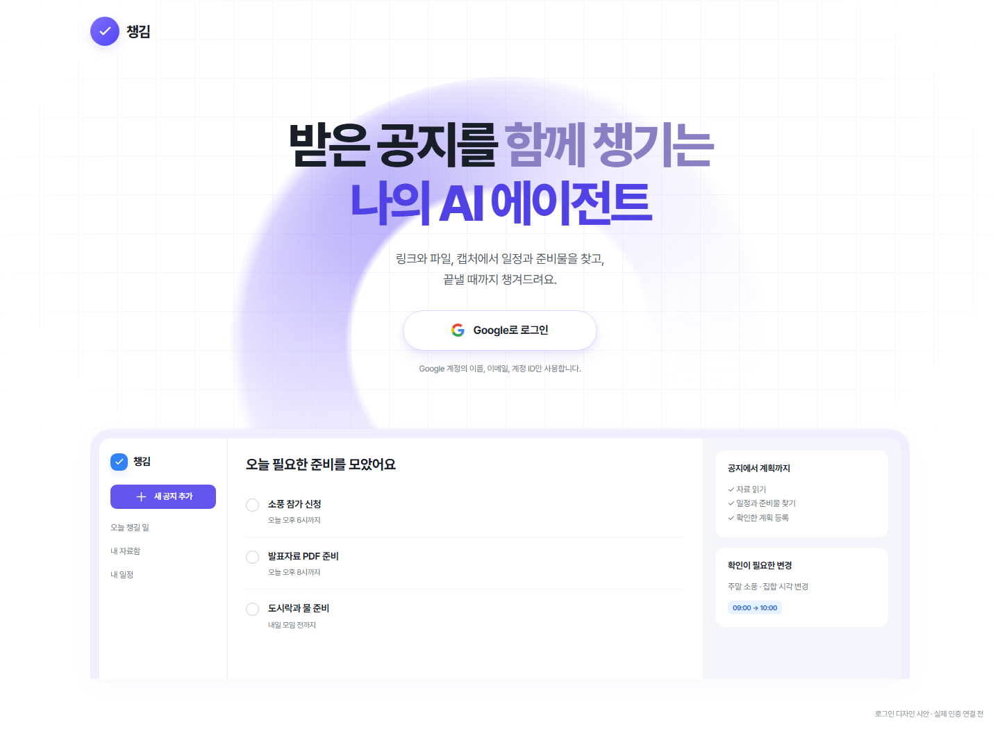
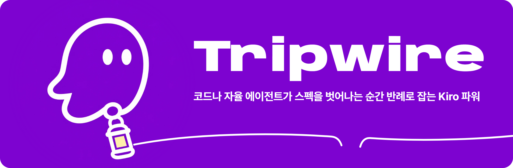
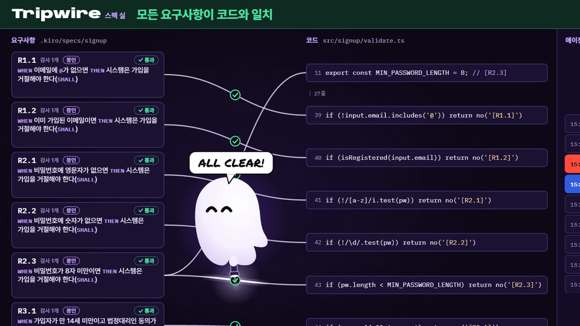

<h1 align="center">캡처한 공지를 일정과 할 일로<br><sub>AI 에이전트 + Kiro Power Tripwire</sub></h1>

<p align="center">캡처한 공지를 AI 에이전트가 읽어 실제 일정과 할 일로 처리해 준다.<br>
그 과정을 만들면서 스펙을 지키게 한 Kiro 파워 Tripwire를 함께 만들었다.</p>

<p align="center">
  
  
  
  <a href="#kiro-power--tripwire"></a>
</p>

<p align="center">
  <a href="#1-문제-정의">문제 정의</a> ·
  <a href="#2-핵심-기능">핵심 기능</a> ·
  <a href="#3-사용-시나리오">사용 시나리오</a> ·
  <a href="#6-설치와-실행">설치와 실행</a> ·
  <a href="#kiro-power--tripwire">Kiro Power</a> ·
  <a href="BUILD_REPORT.md">BUILD REPORT</a>
</p>

**Demo:**

| 데모 | 보여 주는 것 | 영상 |
|---|---|---|
| 🗓️ **AI 에이전트** | 캡처한 공지 → 일정·할 일 등록 | <!-- AI 에이전트 데모 영상 링크 --> |
| 🛡️ **Tripwire** — Kiro Power | 기준을 어긴 저장 → 반례 → Kiro 차단 → 사람의 결정 → 복구 | [영상 보기](https://drive.google.com/file/d/1kThXh9NlS03dPeu2xSn-zYvGBL4IH7N_/view?usp=sharing) |

### 이 레포에 담긴 두 가지

<table>
<tr>
<td width="50%" valign="top">
<h4>🗓️ AI 에이전트 — 공지 → 일정·할 일</h4>
<br>
학교·회사·동네에서 받은 공지를 캡처해 넘기면, 에이전트가 내용을 읽어 실제 일정과 할 일로 처리해 준다.<br><br>
<b>위치</b> <!-- 에이전트 코드 위치 -->
</td>
<td width="50%" valign="top">
<h4>🛡️ Tripwire — Kiro Power</h4>
<br>
이 프로젝트를 위해 만든 Kiro 파워. 스펙의 수용 기준을 실행 가능한 검사로 바꾸고, 코드나 에이전트가 기준을 어기면 반례로 잡아 Kiro 에이전트의 다음 작업을 막는다.<br><br>
<b>위치</b> <code>power/tripwire/</code> · <code>guard/</code> · <code>ui/</code>
</td>
</tr>
</table>

> Kiro를 개발 과정의 어디에 어떻게 썼는지는 [BUILD_REPORT.md](BUILD_REPORT.md)에 두 갈래(AI 에이전트 · Tripwire)로 나눠 단계별로 적었다.

---

## 1. 문제 정의

### 대상 사용자
<!-- 누가 쓰나요? -->

### 문제 상황
<!-- 누가, 어떤 상황에서, 무엇이 불편한지 -->

### 기존 방식과 한계
<!-- 지금은 어떻게 해결하고 있고, 왜 부족한가 -->

### 근거
<!-- 숫자나 출처 -->

### 목표
<!-- 이 프로젝트로 어떻게 바꾸려는지 -->

---

## 2. 핵심 기능

| 기능 | 해결하는 불편 | 코드 위치 |
|---|---|---|
**🗓️ AI 에이전트**

| 기능 | 해결하는 불편 | 코드 위치 |
|---|---|---|
| <!-- 공지 캡처 읽기 --> | | |
| <!-- 일정 등록 --> | | |
| <!-- 할 일 만들기 --> | | |

**🛡️ Tripwire — Kiro Power**

| 기능 | 해결하는 불편 | 코드 위치 |
|---|---|---|
| 수용 기준 → 속성 검사 — 스펙의 기준마다 fast-check 검사를 만들고 변형 구현으로 검사를 검사한 뒤 봉인 | 테스트가 코드를 따라 함께 틀려 위반을 못 잡는 것 | `power/tripwire/skills/`, `guard/src/adopt.ts` |
| 바뀔 때마다 검사 — Kiro가 쓰면 hook이, 사람이 저장하면 `guard serve`가 검사 | 스펙을 벗어난 것을 뒤늦게 아는 것 | `guard/src/check.ts`, `guard/src/humanwatch.ts` |
| 반례와 차단 — 어긴 기준과 최소 반례를 보여 주고 Kiro의 다음 쓰기·셸을 멈춤 | 에이전트가 잘못된 코드를 계속 쌓는 것 | `guard/src/gate.ts`, `ui/` |

## 3. 사용 시나리오

1. <!-- 에이전트 사용 단계 -->
2. 
3. 

## 4. 기대 효과

<!-- 숫자와 단위로 -->

## 5. 차별점

<!-- AI 에이전트의 차별점 -->

- **Kiro Power Tripwire:** 테스트가 코드를 따라 함께 틀리는 문제를 막는다. 수용 기준마다 속성 검사를 만들고, 일부러 틀린 구현(변형)을 잡는지 확인한 뒤 봉인한다. 누가 기준을 어기게 코드를 바꾸면 반례가 나오고 Kiro 에이전트의 다음 작업이 막힌다.

---

## 6. 설치와 실행

**필요한 것:** Node.js 22 이상, Kiro IDE 또는 Kiro CLI

```bash
# 1. 의존성 설치
npm install
cd demo && npm install && cd ..

# 2. guard 빌드와 검사
npx tsc
npx vitest run

# 3. Kiro Power 설치 (Kiro CLI)
kiro-cli powers install power/tripwire

# 4. 스펙 실 화면 (예제 작업 공간)
cd demo
node ../guard/dist/cli.js serve
```

<!-- AI 에이전트 실행 방법 -->

## 7. 테스트

```bash
npx vitest run            # guard 자체 검사
cd demo && npx vitest run # 예제의 봉인된 속성 검사 6개
```

<!-- 에이전트의 봉인된 검사 -->

---

## Kiro Power — Tripwire

Kiro 스펙의 수용 기준(EARS)을 fast-check 속성 검사로 실행해, 코드나 자율 에이전트가 스펙을 벗어나는 순간 반례로 잡는 Kiro 파워다. 판정은 코드가 하고, 결정은 사람이 한다. `guard serve` 화면에서는 검사관이 수용 기준과 코드 줄을 잇는 실을 따라 순찰한다.

**데모 영상:** [Tripwire가 스펙 위반을 잡고 Kiro를 막는 과정](https://drive.google.com/file/d/1kThXh9NlS03dPeu2xSn-zYvGBL4IH7N_/view?usp=sharing)

<table>
<tr>
<td width="50%" valign="top">
<br>
<b>1. 수용 기준을 코드와 잇는다</b><br>
수용 기준마다 봉인된 속성 검사가 있고, 실이 기준과 코드 줄(<code>[R2.3]</code>)을 잇는다.
</td>
<td width="50%" valign="top">
<br>
<b>2. 코드가 바뀌면 바로 검사한다</b><br>
Kiro가 쓰면 hook(PostToolUse)이, 사람이 저장하면 <code>guard serve</code>가 검사한다.
</td>
</tr>
<tr>
<td width="50%" valign="top">
<br>
<b>3. 반례를 찾는다</b><br>
fast-check가 기준을 어기는 입력을 찾아 최소 반례까지 줄인다.
</td>
<td width="50%" valign="top">
<br>
<b>4. 어긴 기준의 실이 끊어진다</b><br>
위반한 기준과 최소 반례가 표시되고 결정 버튼이 나타난다.
</td>
</tr>
<tr>
<td width="50%" valign="top">
<br>
<b>5. Kiro를 막는다</b><br>
문지기 hook(PreToolUse)이 종료 코드 2로 Kiro의 다음 쓰기·셸을 막고, Kiro는 사람에게 묻는다.
</td>
<td width="50%" valign="top">
<br>
<b>6. 사람이 고르면 다시 이어진다</b><br>
"코드를 되돌린다" 또는 "스펙을 고친다"를 고르면 그 작업만 열리고, 초록이 되면 실이 이어진다.
</td>
</tr>
</table>

검사가 약해지는 것도 막는다. 수용 기준마다 일부러 틀린 구현(변형)을 만들어 검사가 잡는지 확인한 뒤 사람이 봉인(`guard adopt`)하고, 봉인된 검사는 에이전트가 고칠 수 없다.

| 구성 | 하는 일 |
|---|---|
| `setup` 스킬 | 작업 공간에 guard·steering·hook 설치 |
| `rule-intake` 스킬 | 한 문장 규칙을 수용 기준으로 |
| `property-tests` 스킬 | 수용 기준을 fast-check 속성 검사로 |
| `check-the-checks` 스킬 | 기준을 어긴 변형 구현으로 검사를 검사 |
| `resolve-violation` 스킬 | 위반 때 반례와 두 선택지를 사람에게 설명 |
| `guard` CLI | 검사·판정·차단·봉인과 화면(Node 내장 모듈만 사용) |

**이 레포에서 확인한 것:** 예제 작업 공간(`demo/`, 가입 검증 스펙)에 설치해 수용 기준 6개를 봉인했고, 사람이 기준을 어기게 코드를 저장하자 수 초 안에 반례가 나오고 Kiro의 다음 셸 실행이 막혔다. 레포 밖 새 작업 공간에도 파워만으로 설치됐다.

<!-- AI 에이전트에 Tripwire를 적용했다면 여기에 -->


---

## 팀

- **팀 번호:** team-027
- **팀명:** Axiom

| 이름 | 역할 |
|---|---|
| honggaheun | 기획, 개발 |

<sub>MIT 라이선스. `ui/fonts/`의 글꼴은 각자의 라이선스를 따른다. Kiro와 Kiro 유령 캐릭터는 Amazon.com, Inc. 또는 그 계열사의 상표이며, 이 프로젝트는 Amazon과 제휴하거나 Amazon의 보증을 받은 것이 아니다.</sub>
